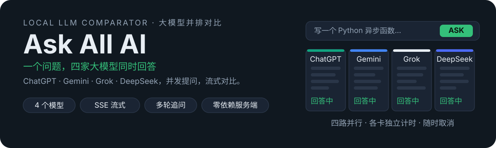
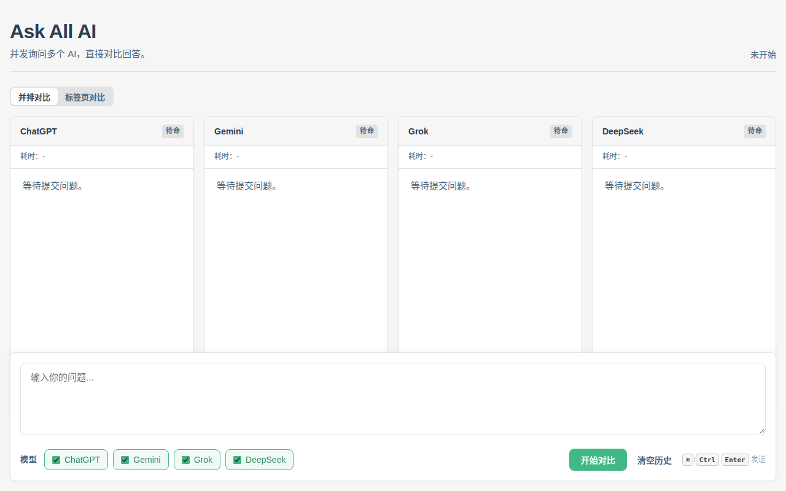

<p align="right"><a href="README.md">中文</a></p>

<p align="center">
  
</p>

<p align="center">
  <a href="https://xiaosang.cc/ask-all-ai/">▶ Preview UI</a>
  ·
  <a href="https://holynova.github.io/ask_all_ai/">GitHub Pages Mirror</a>
  ·
  <a href="https://github.com/holynova/ask_all_ai">GitHub Repository</a>
</p>

> The online link is a static UI preview; full functionality (asking questions, streaming answers) requires running locally with OpenCLI installed.

Ask All AI is a visual front end for the [`@jackwener/opencli`](https://github.com/jackwener/opencli) CLI: ask one question and get ChatGPT, Gemini, Grok, and DeepSeek answering side by side in real time, so you can compare content, latency, and quality directly. The local Node server has zero dependencies and shells out to the opencli you already logged in with — no API keys stored here.

## Screenshot

<p align="center">
  
</p>

## Features

- **Ask in parallel**: one question goes to all four models at once; each model can be toggled on or off individually.
- **Streaming comparison**: answers stream token by token over SSE, four cards side by side, so you can watch them think.
- **Latency comparison**: each card times itself independently, so speed differences are obvious.
- **Follow-ups**: follow-ups continue the same conversation (opencli `--conversation`), so you can keep chatting about a particular answer.
- **Two views**: switch between side-by-side and tabbed comparison.
- **Markdown rendering**: answers render as Markdown, with one-click code copying.
- **Cancel & clear**: cancel an ask in progress anytime; clear history in one click.
- **Diagnostics panel**: checks each model's availability and login state (via opencli's `status` command; Gemini uses `gemini new` since OpenCLI 1.8.0 exposes no Gemini status).
- **Limits**: 8,000 characters per question, 120-second timeout per ask. `Ctrl` + `Enter` to send.

## Run Locally

Prerequisites: Node.js, plus a globally installed, logged-in `@jackwener/opencli` (auth lives in opencli — each model must be logged in there first).

```bash
npm install -g @jackwener/opencli   # log in to each model per the opencli docs
node server.js                       # default http://localhost:3000
PORT=8080 node server.js             # change the port
```

## Tech

- Server `server.js`: native Node `http` module, zero dependencies; spawns opencli child processes (`opencli <model> ask <question> --timeout 120 -f json`) and streams output to the frontend over SSE.
- Endpoints: `GET /ask` (SSE ask), `GET /cancel?requestId=` (cancel), `GET /api/models` (model list).
- The frontend is a single `index.html` (HTML + CSS + JS, no build).

```
index.html          Frontend: four model cards / question box / diagnostics panel / history
server.js           Local server: zero dependencies, spawns opencli, SSE streaming
package.json        npm start runs node server.js
```
