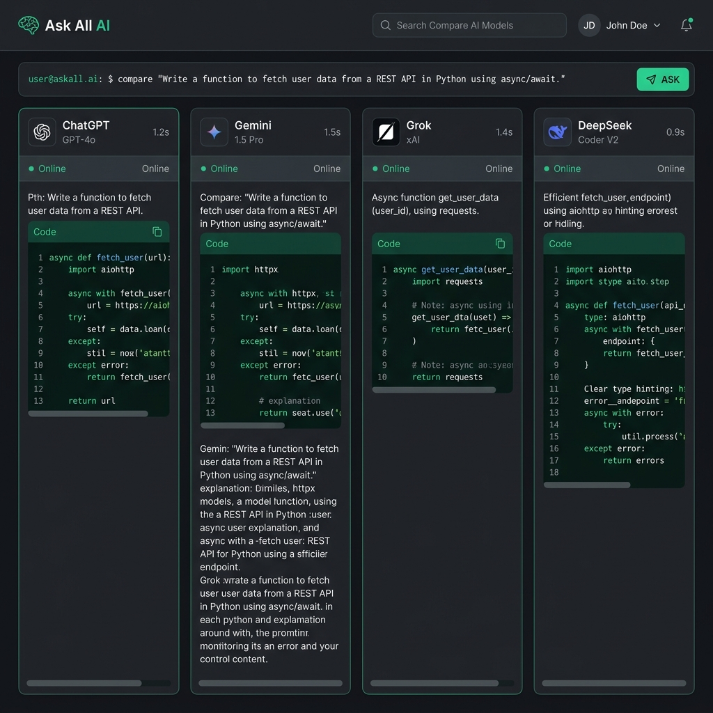

# Ask All AI

`Ask All AI` 是一个基于本地 Web 的大模型对比客户端。它为命令行工具 [`@jackwener/opencli`](https://github.com/jackwener/opencli) 提供可视化界面，支持并发向 ChatGPT、Gemini、Grok 和 DeepSeek 提问并流式对比结果。

### 🔗 相关链接
- **GitHub 仓库**: [github.com/holynova/ask_all_ai](https://github.com/holynova/ask_all_ai)
- **GitHub Pages 预览**: [holynova.github.io/ask_all_ai](https://holynova.github.io/ask_all_ai/)
- **Cloudflare 静态预览**: [ask-all-ai.xiaosang.cc](https://ask-all-ai.xiaosang.cc/)

### 📸 项目截图

Cloudflare 发布的是前端静态页面；提问、登录检查和 OpenCLI 升级仍需在本地运行 `server.js`，不会在 Workers 上伪造后端能力。
